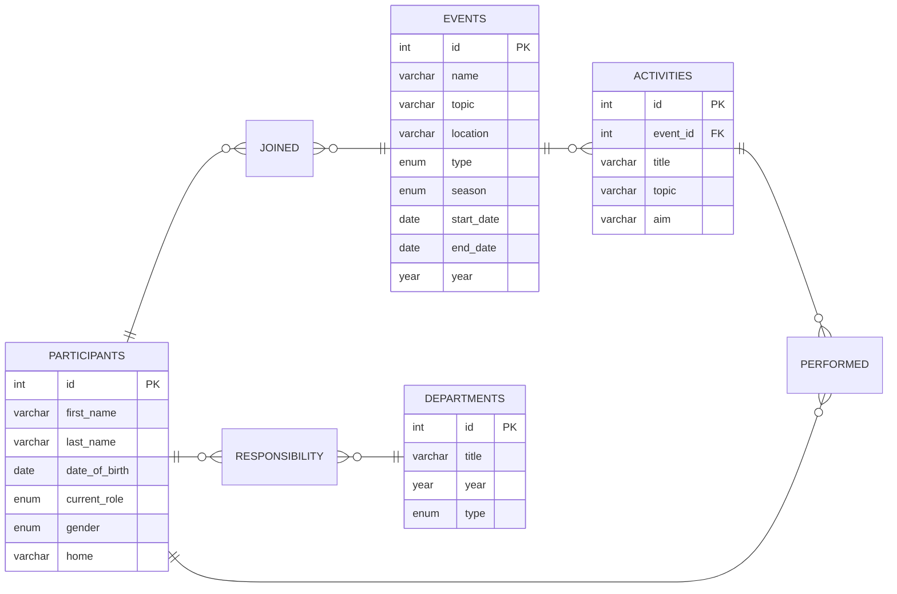

# Zgraya.project

A relational database (MySQL) for **[Zgraya](https://www.instagram.com/zgraya.project/)**, a community that organizes informal camps for children. It stores participants, long-running events, activities held during events, and departments responsible for parts of each event. All data in `seed.sql` is fictional. Information about real participants is confidential and is not stored in this repository.

## Database schema



## Tables

| Table | Purpose |
|---|---|
| `participants` | People in the community, with their current role |
| `events` | Long-running events (camps, online schools) with dates and season |
| `activities` | Lectures, workshops and games held at an event |
| `departments` | Areas of responsibility, one row per department per year |
| `joined` | Which participant took part in which event, and in what role |
| `performed` | Which participant led which activity |
| `responsibility` | Which participant belonged to which department |

`joined`, `performed` and `responsibility` are junction tables for many-to-many relationships.

## Relationships

- An event has zero or more activities; each activity belongs to exactly one event.
- A participant can join many events, and an event has many participants (`joined`).
- A participant can lead many activities, and an activity can have several leaders (`performed`).
- A participant can belong to many departments, and a department has many participants (`responsibility`).

## Views

- `event_roster`: who took part in each event and in what role.
- `activity_performers`: who led each activity and as what (lead or assistant).

## Design decisions

- **Why MySQL.**
  - **Several databases on one server.** Other needs and directions of Zgraya.project can get their own databases on the same server, with common access management and queries across databases. With SQLite each database would be a separate file.
  - **Wider choice of data types.** `VARCHAR(n)`, `ENUM`, `YEAR` and others describe the data more precisely and reject invalid values; SQLite has fewer types and is much looser about them.
  - **Access from different devices.** The server is available over the network, while an SQLite file would have to be copied between devices.
  - **Practical value.** MySQL is widely used in web projects and job vacancies, so experience with it is useful.
- **Role per event.** The role a person had at a specific event is stored in `joined.role`, so history is preserved. `participants.current_role` stores the current status.
- **Current role is maintained manually.** `participants.current_role` is updated by hand and is not overwritten automatically. `inactive` is only ever set manually. A trigger on `joined` could keep the role in sync, but it was not added to keep the schema simple.
- **Departments by year.** "Logistics 2025" and "Logistics 2026" are separate rows (`UNIQUE (title, year)`), so a department's type can change between years without losing history.
- **Surrogate keys.** Junction tables have their own `id`; a composite `UNIQUE` constraint prevents duplicate pairs.
- **Generated column.** `events.year` is calculated from `start_date`, so it cannot get out of sync.
- **Several or no department heads** are allowed on purpose (`responsibility.position`).

## Indexes

I analysed several queries with `EXPLAIN`. Joins on keys use the indexes created automatically for primary keys, foreign keys and `UNIQUE` constraints.

Two lookups perform a full table scan (`type: ALL`): a search by `participants.last_name` and a search by `departments.year` (the composite `UNIQUE (title, year)` index cannot be used when only `year` is filtered). I deliberately did not create extra indexes for them: this database is not meant to store a large amount of data, so a full scan is just as fast and the indexes would be optional. If the dataset grows, these indexes would be the first to add:

```sql
CREATE INDEX idx_participants_last_name ON participants (last_name);
CREATE INDEX idx_departments_year ON departments (year);
```

## Limitations

The schema does not enforce these rules; they should be checked by queries or application logic:

- every activity has at least one leader;
- every department has at least one participant;
- every participant has joined at least one event.

## How to run

```bash
sudo service mysql start
sudo mysql -e "CREATE DATABASE IF NOT EXISTS zgraya;"
sudo mysql zgraya < schema.sql
sudo mysql zgraya < seed.sql
sudo mysql -t zgraya < queries.sql
```

   **Requirements:** MySQL 8.0.31 or newer.
   
      On macOS (Homebrew) use `mysql -u root` instead of `sudo mysql`.
