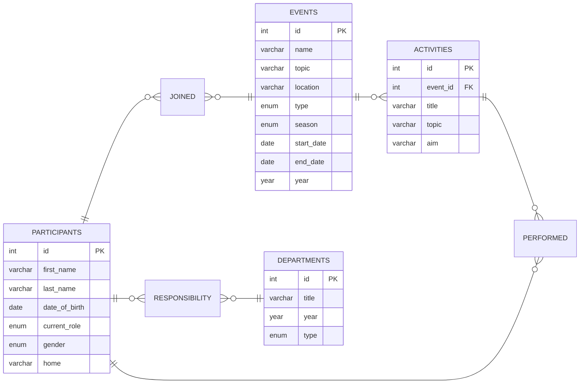

# Zgraya.project

A relational database (MySQL) for **Zgraya**, a community that organizes informal camps for children. It stores participants, long-running events, activities held during events, and departments responsible for parts of each event. All data in `seed.sql` is fictional. Information about real participants is confidential and is not stored in this repository.

## Database schema



## Tables

| Table | Purpose |
|---|---|
| `participants` | People in the community, with their current role |
| `events` | Long-running events (camps, online schools) with dates and season |
| `activities` | Lectures, workshops and games held at an event |
| `departments` | Areas of responsibility, one row per department per year |
| `joined` | Which participant took part in which event, and in what role |
| `performed` | Which participant led which activity |
| `responsibility` | Which participant belonged to which department |

`joined`, `performed` and `responsibility` are junction tables for many-to-many relationships.

## Relationships

- An event has zero or more activities; each activity belongs to exactly one event.
- A participant can join many events, and an event has many participants (`joined`).
- A participant can lead many activities, and an activity can have several leaders (`performed`).
- A participant can belong to many departments, and a department has many participants (`responsibility`).

## Design decisions

- **Role per event.** The role a person had at a specific event is stored in `joined.role`, so history is preserved. `participants.current_role` stores the current status (it also allows `inactive`, which is set manually).
- **Departments by year.** "Logistics 2025" and "Logistics 2026" are separate rows (`UNIQUE (title, year)`), so a department's type can change between years without losing history.
- **Surrogate keys.** Junction tables have their own `id`; a composite `UNIQUE` constraint prevents duplicate pairs.
- **Generated column.** `events.year` is calculated from `start_date`, so it cannot get out of sync.
- **Several or no department heads** are allowed on purpose (`responsibility.position`).

## Limitations

The schema does not enforce these rules; they should be checked by queries or application logic:

- every activity has at least one leader;
- every department has at least one participant;
- every participant has joined at least one event.

## How to run

```bash
sudo service mysql start
sudo mysql -e "CREATE DATABASE IF NOT EXISTS zgraya;"
sudo mysql zgraya < schema.sql
sudo mysql zgraya < seed.sql
sudo mysql -t zgraya < queries.sql
```
